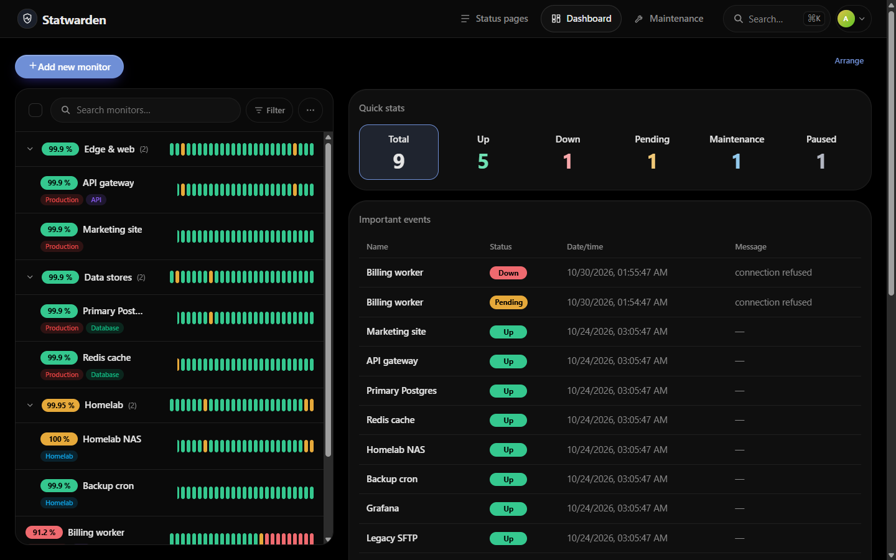
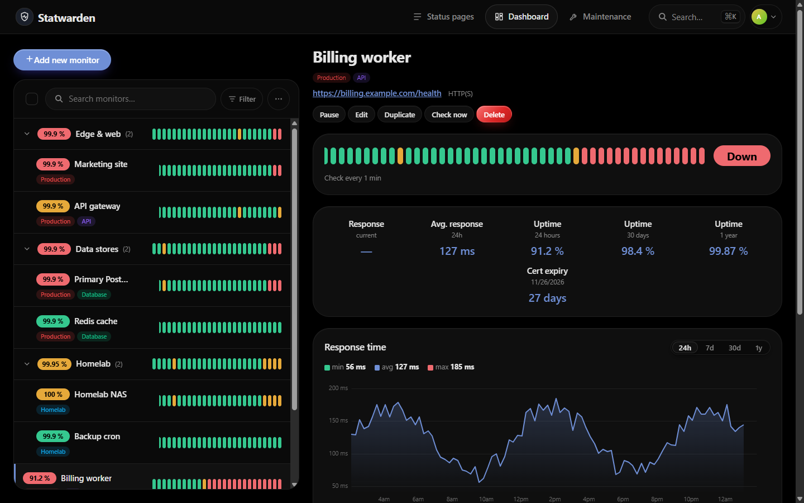
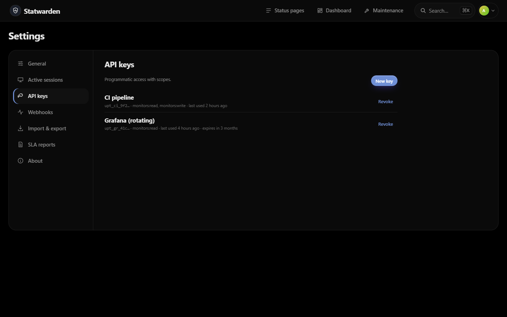
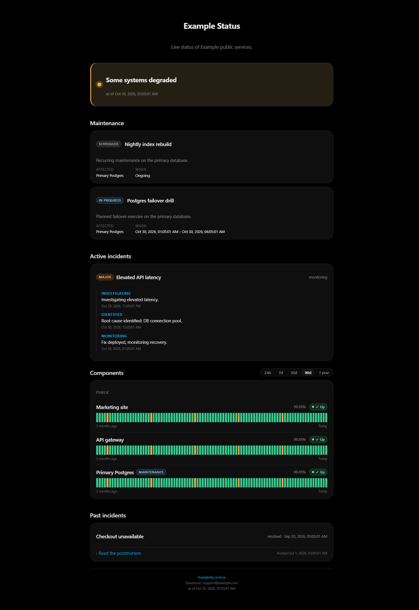
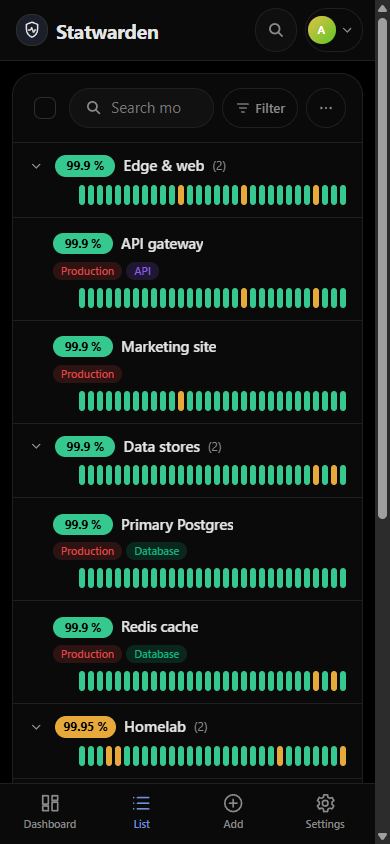

<p align="center">
  
</p>

<h1 align="center">Statwarden</h1>

<p align="center">
  <strong>Self-hosted uptime monitoring for teams.</strong><br>
  One Go binary · PostgreSQL · a fast dashboard you already know how to use
</p>

<p align="center">
  <a href="https://github.com/Ariazonaa/statwarden/actions/workflows/ci.yml"></a>
  <a href="https://github.com/Ariazonaa/statwarden/releases"></a>
  <a href="https://github.com/Ariazonaa/statwarden/pkgs/container/statwarden"></a>
  
  <a href="./LICENSE"></a>
</p>

<p align="center">
  
</p>

Statwarden watches your websites, APIs, databases and servers and tells the right people when something
breaks — with the things a shared monitoring setup needs and single-user tools leave out: users and
roles, SSO, a real REST API, an audit trail and SLA reports.

> **Status:** early but in daily production use by the author. Versions follow [SemVer](https://semver.org);
> while the major version is `0`, minor releases may still change behaviour — see [CHANGELOG.md](./CHANGELOG.md).
> Bugs and planned work live in [GitHub issues](https://github.com/Ariazonaa/statwarden/issues).

## Why

[Uptime Kuma](https://github.com/louislam/uptime-kuma) is excellent for one person watching their own services. Statwarden keeps its familiar layout — monitor list on the left, per-check status bars, quick stats and an event log — and adds what a team needs:

- **Users, roles, SSO.** Admin / user / viewer, OIDC single sign-on, TOTP two-factor, scoped and expiring API keys.
- **A documented REST API.** Everything the UI does, under `/api/v1`, described by an OpenAPI 3.1 document that a test keeps in sync with the router.
- **PostgreSQL.** Hourly and daily roll-ups, p50/p95/p99, uptime over a year without reading a year of raw checks.
- **Alerting that does not spam.** Retries, recovery checks, flapping damping, escalation, resend, quiet hours, digests, maintenance windows.
- **Accountability.** Audit log with CSV export and SIEM forwarding, signed outbound webhooks, recycle bin for deleted monitors.
- **Reports.** SLA reports as CSV and PDF, response-time anomaly detection.
- **Moving over is one upload.** The Uptime Kuma importer reads a Kuma SQLite database or JSON export.

**19 monitor types** — HTTP(S) with keyword / JSON path / header assertions, WebSocket, TCP, UDP, Ping, DNS, NTP, SNMP, RADIUS, TLS certificate, PostgreSQL, MySQL/MariaDB, MongoDB, Redis, Docker, gRPC, MQTT, Steam, Push — and **19 notification channels**, including Slack, Discord, Teams, Telegram, Matrix, Signal, ntfy, Gotify, Pushover, PagerDuty, Opsgenie, e-mail, web push and Apprise for everything else.

Public **status pages** with incidents, post-mortems, custom domains, password protection and a multi-year availability archive.

## Screenshots

<table>
  <tr>
    <td width="50%"><br><sub><b>Monitor detail</b> — per-check bar, uptime over 24 h / 30 d / 1 y, certificate expiry, response time</sub></td>
    <td width="50%"><br><sub><b>Settings</b> — sessions, scoped API keys, webhooks, import &amp; export, SLA reports</sub></td>
  </tr>
  <tr>
    <td width="50%"><br><sub><b>Public status page</b> — maintenance, incidents with updates, post-mortems, 90-day bars</sub></td>
    <td width="50%" align="center"><br><sub><b>On a phone</b> — the same list with a bottom navigation bar</sub></td>
  </tr>
</table>

## Quick start

```sh
git clone https://github.com/Ariazonaa/statwarden.git && cd statwarden
cp .env.example .env
# Set the three secrets in .env: SESSION_SECRET, ENCRYPTION_KEY, POSTGRES_PASSWORD
# (`openssl rand -base64 48` for the two secrets). Startup refuses weak or placeholder values.
docker compose up -d
```

Open http://localhost:3001 and create the first admin account. Production notes — reverse proxies, backups, TLS, bare-metal systemd — are in [docs/deployment.md](./docs/deployment.md).

## Stack

| Layer | Choice |
|---|---|
| Backend | Go (single static binary, embeds the frontend) |
| Database | PostgreSQL (pgx, golang-migrate) |
| Frontend | SvelteKit + TypeScript, Svelte 5 runes, `adapter-static` |
| Live updates | WebSockets (topic-based hub) |
| Design | Flat AMOLED dark theme, Kuma-style layout |
| Deploy | Docker multi-stage build (amd64 + arm64), docker-compose (app + postgres), systemd unit |

## Architecture

See [docs/architecture.md](./docs/architecture.md) for the full picture: monitor scheduler (bounded worker pool, drift-corrected timers, UP→PENDING→DOWN state machine), pluggable `Checker`/`Notifier` registries, topic-based WebSocket hub, session auth with TOTP 2FA, status pages with incident timelines. Adding a monitor type or a notification channel is a new package — see [docs/plugins.md](./docs/plugins.md).

## Development

```sh
# Postgres for local work
docker compose -f docker-compose.dev.yml up -d

# backend (see .env.example)
go run ./cmd/statwarden

# frontend (proxies /api to :3001)
cd web && npm install && npm run dev
```

A `Makefile` wraps the common tasks: `build` (frontend + Go binary, or `frontend` / `backend` separately), `cli`, `dev`, `test`, `vet`, `lint`, `migrate`, `sqlc`, `docker` and `clean`.

`make lint` runs golangci-lint v2 via `go run` at the version pinned in `GOLANGCI_LINT_VERSION` at the top of the `Makefile`, so no local install is needed and CI uses the exact same version — bump that one variable to upgrade.

Contributions are welcome, including AI-assisted ones: see [CONTRIBUTING.md](./CONTRIBUTING.md) and, for AI coding assistants, [CLAUDE.md](./CLAUDE.md) / [AGENTS.md](./AGENTS.md). Security issues: see [SECURITY.md](./SECURITY.md) — please do not open a public issue.

## API

Every instance documents itself. Two forms of the same contract are served straight from the binary:

| Path | What |
|---|---|
| `/api/v1/docs` | Interactive reference — operations by tag, schemas, and a "try it" console |
| `/api/v1/openapi.json` | The OpenAPI 3.1 document, for client generators, Postman and `curl` |

Both are public: they describe the shape of the API and carry no instance data, so an integrator can read them before an account exists.

The reference page fetches the spec at runtime rather than embedding a copy, so it cannot fall out of date; a contract test walks the live router and fails the build if the spec and the routes ever disagree. It has no external dependencies — no CDN, no webfont — so it works on an air-gapped host like the rest of the binary. "Try it" issues same-origin requests with your session cookie, which means it acts as you, against real data.

## CLI

`statwarden-cli` manages monitors from a terminal. It authenticates with an API key against the REST API and never touches the database, so it works against a remote instance just as well as a local one.

```sh
make cli

# Mint a key in the web UI under Settings > API keys — the secret is shown once.
export STATWARDEN_BASE_URL=https://statwarden.example
export STATWARDEN_API_KEY=...

./statwarden-cli monitor list
./statwarden-cli monitor list --status down --json
./statwarden-cli monitor show 7
./statwarden-cli monitor create --name API --type http --config '{"url":"https://example.com"}'
./statwarden-cli monitor pause 7
./statwarden-cli monitor resume 7
./statwarden-cli monitor delete 7            # prompts; --yes to skip
```

The key is read from the environment (or from `$STATWARDEN_CONFIG`, a `0600` JSON file with `base_url` and `api_key`) and deliberately **not** accepted as a flag — argv is readable by any local user and is recorded in shell history.

Reading needs a key with the `read` scope. Creating, pausing, resuming and deleting need the `write` scope **and** an owning user whose role is at least `user`; a `viewer` gets a 403.

Exit codes are `0` success, `1` request or transport failure, `2` usage error, so a script can branch on them. `--json` prints the raw API response for piping into `jq`.

## License

[MIT](./LICENSE) © 2026 Ariazonaa
